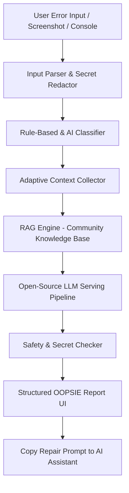

# OOPSIE System Architecture

OOPSIE is an open-source AI Error Recovery Copilot designed to transform raw terminal crashes, build logs, and console traces into safe, executable repair plans.

## Core Components
1. **Input Parser (`/rules/secret-redaction-patterns.json`)**: Redacts credentials (JWTs, DB passwords, API keys) prior to prompt evaluation.
2. **Error Classifier (`/rules/classifiers.json`)**: Categorizes errors into dependency, env vars, database, build, deployment, or runtime.
3. **Knowledge Base RAG (`/knowledge-base/`)**: Matches error signatures against community-curated markdown recipes.
4. **Open-Source LLM Inference**: Formats prompts using Hugging Face endpoints, Ollama, or vLLM running open-weight coding models (Qwen-Coder, DeepSeek-Coder, StarCoder).
5. **Safety Guardrails**: Prevents destructive schema drops or unauthenticated exposures.
