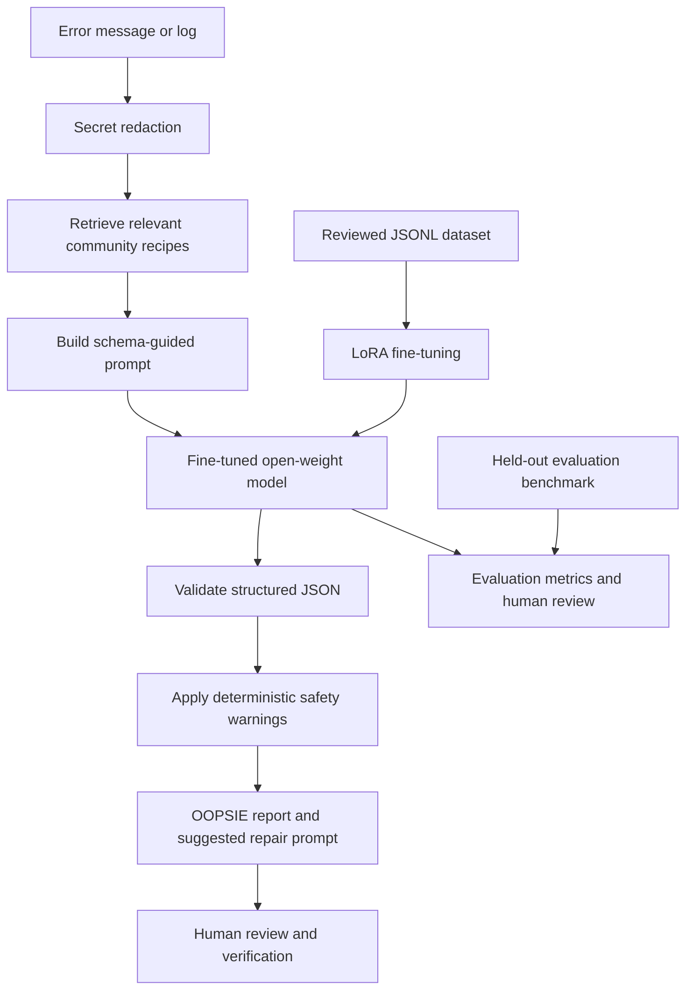

# OOPSIE architecture

OOPSIE combines an open, reviewed error-recovery dataset, a fine-tuning pipeline for a selected open-weight coding model, a held-out evaluation benchmark, and simple inference interfaces.

## Components

- `data/`: reviewed JSONL splits and the output schema.
- `training/`: validation/redaction/preprocessing, LoRA training configuration and scripts, and optional adapter merge.
- `evaluation/`: held-out cases, schema/category/risk/latency checks, and human-review rubric.
- `inference/`: schema validation, local recipe retrieval, secret redaction, local HTTP API, and CLI.
- `knowledge-base/`: community Markdown recipes retrieved as supporting prompt context.
- `rules/`: auditable error-classification, safety, and secret-redaction patterns.
- `apps/web-demo/`: interface that calls the inference API and shows a clear connection error when it is unavailable.
- `apps/vscode-extension/`: optional future integration; not the core product.

The repository structure and API support do not imply that any particular fine-tuned checkpoint, benchmark score, hosted service, or production guarantee is available.
